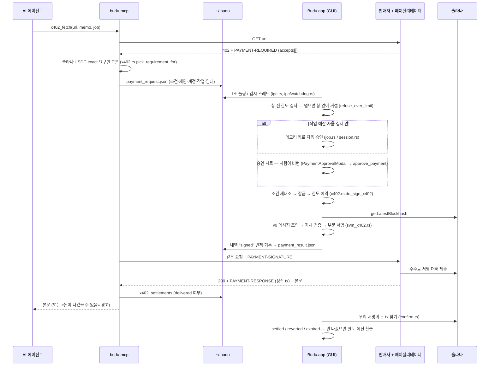

# 부두 구조 — 처음 읽는 사람을 위한 지도

부두는 **AI 에이전트가 쓰는 로컬 솔라나 지갑**이다. 에이전트(Claude Code 등)가 x402 유료 API 를 부르면
402 응답의 결제 조건을 지갑에 넘기고, 지갑은 사람의 승인(또는 사람이 미리 연 예산) 안에서만 USDC 결제에 서명한다.
**키는 맥 밖으로 안 나가고, 키를 만지는 프로세스는 GUI 하나뿐이다.**


---

## 1. 세 프로세스와 신뢰 경계

```
 AI 에이전트 ──stdio MCP──▶ budu-mcp (Rust)          ~/.budu/ (파일)            Budu.app (Tauri: Rust + React)
                           · HTTP·402 파싱·재요청  ──payment_request.json──▶  · 키 보관(암호화)·서명
                           · 키 없음, 비번 없음    ◀──payment_result.json───  · 한도·잠금·작업 예산
                           · 요청만 한다           ──x402_settlements──────▶  · 승인 창(사람)·내역·정산 확정
                                                   ◀──app_alive.json────────
```

| 프로세스 | 폴더 | 하는 일 | 못 하는 일 |
|---|---|---|---|
| **GUI** (Tauri) | `src-tauri/` + `src/` | 키 파생·암호화 저장, 한도 판정, 트랜잭션 조립·자체 검증·서명, 승인 창, 내역, 정산 확인 | 판매자에게 HTTP 를 보내지 않는다 |
| **MCP 어댑터** | `budu-mcp/` | 판매자 HTTP, 402 의 요구를 **닫힌 쪽으로** 고르기, 결제 헤더 조립·재요청, 받은 응답 저장 | 키·비번을 본 적이 없다. 한도도 GUI 가 건다 |
| **데모 판매자** | `budu-port/` (Node) | 부산항 데이터(파고·조석·혼잡)를 x402 로 건당 판다. 공식 `@x402/express` | — |

두 Rust 크레이트는 **공유 크레이트 없이** `shared/policy.rs`(~/.budu 파일을 읽는 규칙·내역 형식)와
`shared/solana.rs`(주소·ATA·잔액 RPC)를 `#[path]` 모듈로 같이 컴파일한다. 같은 파일을 두 곳에서 다르게 읽으면
돈이 딴 체인·딴 계정으로 가므로 정본을 하나로 둔다.

**요청 파일은 아무나 쓸 수 있다**고 가정한다. 그래서 GUI 는 요청의 체인·계정·금액·받는 주소를 자기 설정과 다시 대조하고,
작업 이름표(`job`)는 권한이 아니라 이름일 뿐이며, 예산은 사람이 승인 창에서만 연다.

**알려진 한계(1.0):** 설정 파일(`settings.json` — 한도·자율 결제)과 화이트리스트(`trusted*.json`)는 평문이고
무결성 표시가 없다. 같은 사용자 권한으로 도는 악성 코드는 요청 파일처럼 이 파일들도 고칠 수 있다 —
**자율 결제 세션이 열려 있는 동안**엔 한도·화이트리스트를 바꿔 승인 창 없이 결제를 낼 수 있다는 뜻이다.
세션이 닫혀 있으면(기본) 모든 결제가 비밀번호를 거치므로 이 경로는 없다. 자율 결제는 믿는 환경에서만, 짧게 켠다.
세션 키에서 파생한 MAC 으로 두 파일을 묶는 일은 다음 버전 몫이다.

---

## 2. 결제 한 건의 순서

원칙: **승인 → 블록해시 → 조립 → 자체 검증 → 서명.** 402 를 받자마자 조립하면 사람이 1분 고민하는 사이
블록해시(60~90초)가 죽는다.



핵심 불변식 몇 개:

- **서명 = 돈이 나간 것으로 센다.** 부분 서명된 tx 도 «내 USDC 를 빼갈 권한» 이라 서명하는 순간 일일 한도에 적는다.
  정산 확인에서 «안 나감»(만료·체인 실패)일 때만 기록 하나당 한 번 돌려준다(`limits::refund_once`).
- **「없음」은 확정된 뒤에만 말한다.** 블록해시의 마지막 유효 높이가 finalized 된 뒤 목록을 끝까지 봤을 때만 expired.
  끝까지 못 봤으면 판정을 미룬다 — 나간 돈을 안 나갔다고 적는 쪽이 위험한 실패다(`confirm.rs` 머리).
- **판매자가 준 tx id 를 믿지 않는다.** 그 tx 의 `signatures[1]` 이 우리 서명인지 본다.
- **돈의 행방 세 갈래**(`flow.rs payment_state`): 안 나감 / 나감 / 나갔을 수 있음. 마지막 둘이면 AI 에게 «다시 내지 마라» 를 붙인다.

---

## 3. 어디부터 읽을까

결제 코어 → 정책 → 승인 → 어댑터 순서가 의존 방향과 같다.

| 순서 | 파일 | 무엇을 보면 되나 |
|---|---|---|
| 1 | `src-tauri/src/svm_x402.rs` (~380줄) | 트랜잭션 4명령 손 직렬화, `verify_message` 의 자체 검증 규칙, 정답지 테스트 `matches_official_client_byte_for_byte` |
| 2 | `src-tauri/src/x402.rs` | 정책 껍데기: 조건 대조 → 잠금 → 한도 예약 → 블록해시 → 서명 → 먼저 적기. 실패 시 환불 |
| 3 | `src-tauri/src/limits.rs` · `job.rs` · `session.rs` | 한도 장부, 작업 예산(사람이 연 «이 작업 N USDC 까지»), 자율 결제 세션. 키는 메모리에만(zeroize) |
| 4 | `src-tauri/src/ipc.rs` · `ipc/watchdog.rs` | 요청·결과 파일, 승인 중재(동시에 한 건), 웹뷰가 잠들어도 창을 깨우는 감시 스레드 |
| 5 | `src-tauri/src/confirm.rs` · `history.rs` | 정산 확정, 감사 로그(내역) |
| 6 | `budu-mcp/src/flow.rs` · `x402.rs` · `payment.rs` | 402 고르기, 리다이렉트 가드, 한 번에 한 결제, 승인 대기, 결과 JSON |
| 7 | `src-tauri/src/keys.rs` · `wallet.rs` | BIP-39 → SLIP-0010 ed25519(팬텀과 같은 경로), Argon2id + AES-256-GCM |
| — | `shared/policy.rs` | 두 크레이트가 같이 읽는 파일 규칙 |

프론트(`src/`)는 표시와 입력만 한다. 금액·상태 판정은 `src/lib/ledger.ts` 한 곳, 승인 시트는
`src/components/PaymentApprovalModal.tsx`, 큰 창의 뿌리는 `src/screens/WalletScreen.tsx`.

---

## 4. 직접 짠 것과 기댄 것

| | 무엇 | 왜 |
|---|---|---|
| 직접 | 솔라나 v0 메시지·명령 직렬화, SLIP-0010, compact-u16, 주소 정렬 | Anza 인터페이스 크레이트는 버전이 두 벌로 갈려 Tauri 의존성과 부딪힌다. 대신 **공식 클라이언트 바이트와 한 바이트도 다르지 않음**을 테스트로 고정 |
| 직접 | 솔라나 JSON-RPC (reqwest) | 같은 이유. 부르는 메서드가 몇 개 안 된다 |
| 기댐 | ed25519-dalek, argon2, aes-gcm, bip39 계열, rmcp(MCP SDK), Tauri 2 | 암호 기본 요소와 플랫폼은 직접 짜지 않는다 |

정답지는 `budu-port/golden.mjs` 가 공식 `@x402/svm` ExactSvmScheme 으로 고정 입력의 tx 를 만들어
`src-tauri/src/svm_x402_golden.json` 에 남긴 것이다(네트워크 없이, 가짜 RPC 로).

---

## 5. 데이터 (`~/.budu/`)

| 파일 | 쓰는 쪽 → 읽는 쪽 | 내용 |
|---|---|---|
| `wallet.enc` | GUI | 암호화된 시드 + 평문 계정 주소 목록(MCP 도 비번 없이 주소를 읽는다) |
| `settings.json` | GUI → MCP | 체인·한도·RPC·언어 |
| `payment_request.json` / `payment_result.json` | MCP ↔ GUI | 결제 요청 한 건 / 그 결과 |
| `app_alive.json` / `mcp_alive.json` | 서로 | 하트비트(앱이 꺼져 있으면 MCP 가 즉시 안내) |
| `history[-<체인>][-a<계정>].json` | GUI → MCP | 감사 로그. 넘친 기록은 옆의 `.archive.jsonl` |
| `sol_sends[-<체인>][-a<계정>].json` | GUI | 사람이 직접 한 SOL 보내기 기록(USDC 내역·한도와 따로). «보내는 중» 은 체인 확인·블록해시 만료로 결말 |
| `x402_settlements[-<체인>].json` | MCP → GUI | 판매자가 준 정산 결과와 «본문 받음» 신호 |
| `spend` · `trusted` · `job_names` `[-<체인>].json` | GUI | 오늘 사용액 · 화이트리스트 · 작업 별명 |
| `lock.json` | GUI | 긴급 잠금 |
| `approvals/<id>.json` | GUI → MCP | 결제 시도 기록(sending → done/failed/handed). 요청이 사라져도 MCP 가 결말을 읽는 자리. 경합은 순서로 닫는다: **GUI 는 기록을 먼저 쓰고 요청을 확인, MCP 는 시간 초과면 요청을 먼저 지우고 기록을 읽는다**(`shared/policy.rs` 결제 시도 기록 절) |

데브넷은 접미 없이, 메인넷은 `-101` 접미, 계정 1 이상은 `-a<n>` 접미(`shared/policy.rs chain_file_name·account_file_name`).
연습 기록이 실돈 장부에 섞이지 않게 이름부터 가른다.

---

## 6. 검사

```bash
npm run check
```

`scripts/check.sh` 한 줄: `tsc` → `budu-mcp` clippy(`-D warnings`)·test → 사이드카 빌드(없으면) → `src-tauri` clippy·test → `budu-port` 단위 테스트.
`npm run lint` / `npm run test` 는 각각 그 반쪽.

- 단위 테스트는 큰 모듈만 옆 파일 `<모듈>/tests.rs` 로 뺐고(`ipc`·`history`·`wallet`·`settings`·`connect`·`limits`·`tray`, MCP 의 `payment`·`flow`·`x402`), 나머지는 파일 안 `mod tests` 다.
- 네트워크가 필요한 테스트(데브넷 실결제·실 RPC)는 `#[ignore]` — `cargo test -- --ignored` 로 따로 돈다.
- 아직 `cargo fmt` 를 맞추지 않았다(맞추면 diff 가 저장소 전체라 따로 한 번에 한다).

---

## 7. 알려진 한계 (데모 범위)

- 결제 방식은 x402 V2 · 솔라나 `exact` · USDC 하나. EVM·V1·다른 토큰은 버렸다.
- 한 번에 결제 한 건, 열린 작업 예산 하나.
- 서명·공증 없는 빌드. 맥 전용.
- 정산 확인(`confirm.rs`)은 **지금 활성 체인**의 내역 중 본 파일에 남은 기록만 본다. 보관 파일로 밀려난 기록·다른 체인의 기록은
  «정산 대기» 로 남고 한도도 돌려받지 못한다(보수 쪽 실패 — 나간 돈을 안 나갔다고 적지는 않는다).
- 요청·결과를 파일로 주고받는다(소켓 아님) — 두 프로세스가 따로 죽고 살아도 상태가 남고, 사람이 `~/.budu` 를 열어 볼 수 있어서.
  대신 임대(lease)·하트비트·한 건 중재 같은 장치가 그만큼 붙었다(`ipc.rs`).
